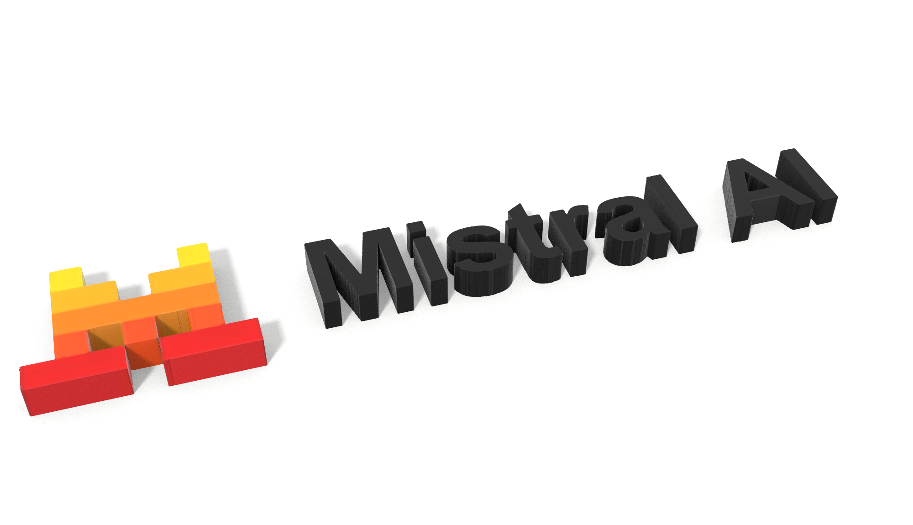

# Paper Mache

**3d model design, via mcp (rust).** Paper Mache is a small, fully open-source 3D modeler and renderer that a coding
agent drives over MCP: it adds shapes, sets materials, aims the camera, renders, looks at the picture and refines, then
saves the scene, exports it for printing or renders it again from the command line. It replaces Blender for our
build-step pictures: one binary, no Python, no GPU, no add-on.



- One unit is one millimetre, Z is up, right-handed, rotations in degrees as Blender's XYZ euler (Rz · Ry · Rx).
- A CPU ray tracer (rayon, a binned-SAH BVH, analytic shapes): a sun with soft shadows, a sky with ambient occlusion and
  one bounce, metal and glossy reflections, see-through materials, emission, sRGB output, transparent backgrounds.
  20,000 small parts at 2400 x 1600 and 16 samples render in about 15 s on 16 cores.
- Fine detail: bevelled boxes, cones and frustums, ellipsoids, tori, rods, wires as tubes, flat text in DejaVu Sans
  Bold, `.obj` and `.stl` meshes, and `object_array` for rows of pins, teeth or rivets.
- Pictures into solids: one `image` object raises a `.png` into 3D, every column in its own pixel's colour, with
  smooth walls from the anti-aliased edges. A logo comes out exact to the pixel (`examples/mistral/`).

MIT licensed (`LICENSE`). Every dependency is MIT or Apache-2.0 (serde, serde_json, rayon, png, ab_glyph, base64); the
embedded font is DejaVu Sans Bold under the Bitstream Vera license with public-domain DejaVu changes
(`assets/LICENSE-DejaVu.txt`).

## Install

Windows: `papermache.exe` from the latest release (github.com/brandonmlicea/papermache/releases). Anywhere Rust runs:

```sh
cargo build --release          # target/release/papermache(.exe)
cargo test --release
```

## Command line

```sh
papermache render scene.json -o out.png [--samples N] [--scale F]   # prints one JSON line: file, size, ms, points
papermache export scene.json -o model.obj [--tag T]                 # or model.stl; .obj writes a .mtl beside it
papermache info scene.json                                          # counts, bounds, materials
papermache mcp                                                      # MCP server on stdin/stdout
papermache --version
```

`render` projects every named point in the scene's `points` to pixels (x right, y down from the top left), so labels
and arrows can be drawn onto the picture afterwards.

## Scene format

```json
{
  "materials": {"clay": {"color": [0.8, 0.35, 0.15], "metallic": 0, "roughness": 0.5, "emission": [0, 0, 0], "opacity": 1}},
  "objects": [
    {"name": "block", "shape": "box", "size": [40, 30, 20], "radius": 3, "position": [0, 0, 10], "rotation": [0, 0, 20],
     "scale": [1, 1, 1], "material": "clay", "tags": ["parts"], "hidden": false}
  ],
  "camera": {"eye": [60, -140, 90], "look": [0, 0, 0], "up": [0, 0, 1], "projection": "perspective", "lens": 50,
             "fov": null, "width": 100, "size": [1600, 1200]},
  "lights": {"sun": {"direction": [0.45, -0.35, 0.82], "angle": 8, "strength": 1.7},
             "sky": {"color": [1, 1, 1], "strength": 0.7}, "background": "transparent"},
  "render": {"samples": 16},
  "points": {"corner": [20, 15, 20]}
}
```

Colours are linear 0-1. Every field has a default. Shapes, in local space before scale, rotation and position:

| Shape | Fields |
| --- | --- |
| `box` | `size` [x, y, z], centred; `radius` bevels every edge |
| `cylinder` | `radius`, `height` along Z, centred; `radius_top` makes a cone or frustum |
| `sphere` | `radius`; a non-uniform `scale` makes an ellipsoid |
| `torus` | `major`, `minor`, lying in XY |
| `rod` | `from`, `to`, `radius`, `radius_top`: a capped frustum between two world points (`position` shifts it) |
| `tube` | `points`, `radius`: a smooth wire through the points |
| `plane` | `size` [w, h], facing +Z, two-sided |
| `text` | `text`, `size` (em), `align` center, left or right: flat letters in XY, readable from +Z, centred on their ink |
| `image` | `file` (.png), `width` mm (height from the picture), `depth` mm (1), `key` colour to drop ([1, 1, 1], white), `detail` cells a pixel (4): the picture raised into a solid, centred, in its own colours |
| `mesh` | `file` (.obj or .stl), or `vertices` and `faces` |

Camera: `lens` is a focal length in mm on a 36 mm sensor across the larger side of the picture, as in Blender; `fov`
(degrees across the larger side) overrides it. `orthographic` shows `width` mm across the larger side. A camera looking
straight down has world +X to the right and +Y up. The sun's `direction` points toward the sun; `angle` is its size in
degrees, and softens shadows. `background` is a colour or `"transparent"`; without it the sky shows.

## MCP tools

| Tool | What it does |
| --- | --- |
| `scene_info` | Counts, bounds, materials, camera, lights, and each object's name, shape, material, tags and world bounds |
| `scene_clear`, `scene_load`, `scene_save` | Start over, open a scene JSON file, save one |
| `object_add` | One object (`object`) or many (`objects`); returns their names |
| `object_update` | Merges fields into an object, or every object with a `tag`; `new_name` renames |
| `object_remove` | By name or tag |
| `object_array` | `count` copies, each `offset` (and `rotate`) one step further |
| `material_set` | Colour, metallic, roughness, emission, opacity |
| `camera_set`, `camera_frame` | Set the camera, or aim it so everything (or a tag) fills the view from a direction |
| `lights_set` | Sun, sky, background |
| `render` | Renders and returns the picture (at most `max_size` px, default 800, 8 samples); `path` saves the full size |
| `project` | World points to pixels |
| `export` | `.obj` (+ `.mtl`) or binary `.stl` of the visible objects or a tag |

### Add it to Claude Code (or any MCP client)

In the project's `.mcp.json`:

```json
{"mcpServers": {"paper-mache": {"type": "stdio", "command": "C:/path/to/papermache.exe", "args": ["mcp"]}}}
```

or `claude mcp add paper-mache -- C:/path/to/papermache.exe mcp`. The server speaks newline-delimited JSON-RPC 2.0
on stdin and stdout and keeps one scene in memory for the session.

## Files

| Path | What |
| --- | --- |
| `src/scene.rs` | The scene format and how each shape becomes primitives |
| `src/geom.rs`, `src/bvh.rs` | Ray and shape intersections, the BVH |
| `src/render.rs` | Camera, projection, shading, PNG |
| `src/text.rs` | Text masks from the embedded font |
| `src/image.rs` | Pictures raised into solids: coverage, colours, the grid walk |
| `src/mesh.rs` | `.obj`/`.stl` in, tessellation and `.obj`/`.stl` out |
| `src/mcp.rs`, `src/tools.rs` | The MCP server and its tool schemas |
| `src/main.rs` | The command line |
| `examples/hello.json` | Every shape on one ground plane |
| `examples/mistral/` | A logo copied exactly into 3D, its colours checked with oklch (`examples/mistral/README.md`) |
| `tests/core.rs` | Hits, projection, rendering, pictures raised in their own colours, MCP round trip, export |
