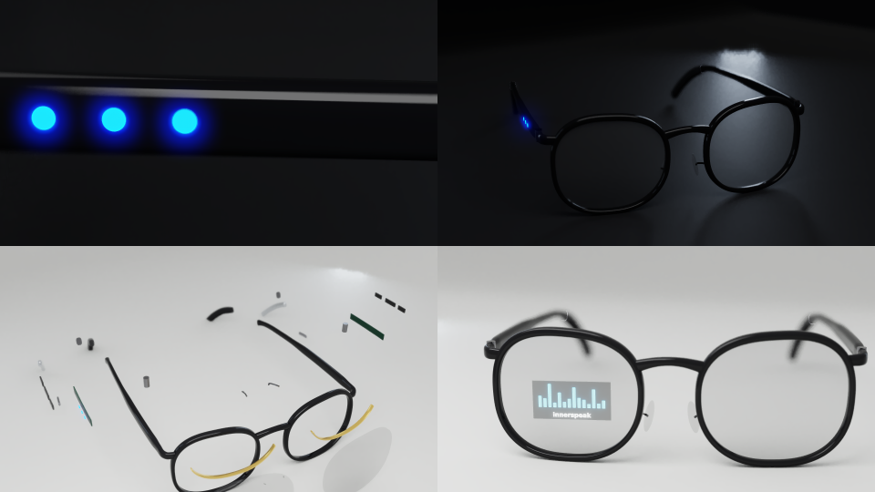

# Paper Mache

**3d model design, via mcp (rust).** Paper Mache is a small, fully open-source 3D modeler and renderer, with an editor you drive by hand and an MCP server a coding
agent drives: it adds shapes, sets materials, aims the camera, renders, looks at the picture and refines, then
saves the scene, exports it for printing or renders it again from the command line. Since 0.3 it also makes product
films: a timeline on any field, studio lamps, depth of field, a film renderer, and a cut laid on a song's beats. It
replaces Blender for our build-step pictures and product ads: one binary, no Python, no GPU, no add-on.


- One unit is one millimetre, Z is up, right-handed, rotations in degrees as Blender's XYZ euler (Rz · Ry · Rx).
- A CPU ray tracer (rayon, a binned-SAH BVH, analytic shapes): a sun with soft shadows, a sky with ambient occlusion and
  one bounce, metal and glossy reflections, see-through materials, emission, sRGB output, transparent backgrounds.
  20,000 small parts at 2400 x 1600 and 16 samples render in about 15 s on 16 cores.
- Fine detail: bevelled boxes, cones and frustums, ellipsoids, tori, rods, wires as tubes, flat text in DejaVu Sans
  Bold, `.obj` and `.stl` meshes, and `object_array` for rows of pins, teeth or rivets.
- Pictures into solids: one `image` object raises a `.png` into 3D, every column in its own pixel's colour, with
  smooth walls from the anti-aliased edges. A logo comes out exact to the pixel (`examples/mistral/`).
- Modeling for products: `lathe` turns a profile into crowns, dials and knobs (with knurled `ridges`), `extrude` pushes
  an outline or rounded rectangle into buttons, bezels and frames (`bevel`, `wall`), `backdrop` is a studio sweep, and
  any mesh takes smooth normals and Loop `subdivide`. `.glb`/`.gltf` come in with their node tree, materials (colour,
  metal, roughness, emission strength, transmission, clear coat) and PNG base colour textures, a part at a time.
- Look: area, spot and point lamps beside the sun and sky, soft shadows, a clear coat, image textures on UVs, brushed,
  spun, noise, gradient and checker patterns, screens that play a frame sequence as light, depth of field, motion
  blur, adaptive sampling that stops on settled pixels, an edge-aware denoiser, bloom and a filmic curve.
- Motion: keyframes on any field (objects by name or tag, materials, camera, lamps), eased or splined; `explode`
  takes an assembly apart and back; `film` renders the timeline and encodes an mp4 with ffmpeg; `beats` finds a song's
  tempo and beats in Rust; `cut` lays shots on them and muxes the song; `agentcut` sends the result to AgentCut.



MIT licensed (`LICENSE`). Every dependency is under a permissive licence: MIT or Apache-2.0 (serde, serde_json, rayon,
png, ab_glyph, base64, tiny_http, hound, ureq and most of their own), with ISC, BSD-3-Clause, Zlib, Unicode-3.0 and
CDLA-Permissive-2.0 (the TLS root list) among ureq's; the embedded font is DejaVu Sans Bold under the Bitstream Vera license with public-domain DejaVu changes
(`assets/LICENSE-DejaVu.txt`).

## Install

Windows: `papermache.exe` from the latest release (github.com/brandonmlicea/papermache/releases). Anywhere Rust runs:

```sh
cargo build --release          # target/release/papermache(.exe)
cargo test --release
```

## The editor

Run `papermache` with nothing after it (or double-click `papermache.exe`), or `papermache edit scene.json`: the editor
opens in your browser on 127.0.0.1, drawn live by Paper Mache's own renderer, sharper the longer you look.

- Drag to orbit, right-drag (or Shift-drag) to pan, the wheel to zoom; click an object to select it.
- Arrow keys and PageUp/PageDown move the selection 1 mm (Shift 10, Alt 0.1), Q and E turn it 15 degrees, F frames it,
  Delete removes it, Ctrl+D duplicates it, Ctrl+Z and Ctrl+Y undo and redo, Ctrl+S saves, Esc clears the selection.
- Every field of the selected object, its material (colour, metal, roughness, see-through, glow), the camera, the sun,
  the sky and the background, edited in the side panel; JSON edits the object or the whole scene as text.
- Add any shape; `image` asks for a `.png` and raises it into a solid. Render opens the full-size picture in a new
  tab; Export writes `.stl` or `.obj`.
- The same scene answers MCP at `http://127.0.0.1:7820/mcp`, so a coding agent can edit while you watch: point Claude
  Code at it with `{"type": "http", "url": "http://127.0.0.1:7820/mcp"}`. Requests from other websites are refused.

## Command line

```sh
papermache [edit scene.json] [--port N] [--no-open]               # the editor in your browser
papermache render scene.json -o out.png [--samples N] [--scale F] [--time S]   # one JSON line: file, size, ms, points
papermache film scene.json -o frames/ [--fps N] [--from S] [--to S] [--samples N] [--scale F] [--no-mp4] [--resume]
papermache beats song.wav                                           # bpm, beats, downbeats, onsets (mp3, flac... via ffmpeg)
papermache cut cut.json -o ad.mp4 [--samples N] [--scale F] [--frames dir] [--resume]
papermache agentcut ad.mp4 --project NAME [--start S] [--url U] [--key K]
papermache export scene.json -o model.obj [--tag T]                 # or model.stl; .obj writes a .mtl beside it
papermache info scene.json                                          # counts, bounds, materials (or a .glb's nodes)
papermache mcp                                                      # MCP server on stdin/stdout
papermache --version
```

`render` projects every named point in the scene's `points` to pixels (x right, y down from the top left), so labels
and arrows can be drawn onto the picture afterwards. `film` writes `frame_00001.png...` and, when ffmpeg is on the
PATH, `film.mp4` beside them; `--resume` skips frames already there.

## Scene format

```json
{
  "materials": {"clay": {"color": [0.8, 0.35, 0.15], "metallic": 0, "roughness": 0.5, "emission": [0, 0, 0], "opacity": 1}},
  "objects": [
    {"name": "block", "shape": "box", "size": [40, 30, 20], "radius": 3, "position": [0, 0, 10], "rotation": [0, 0, 20],
     "scale": [1, 1, 1], "material": "clay", "tags": ["parts"], "hidden": false}
  ],
  "camera": {"eye": [60, -140, 90], "look": [0, 0, 0], "up": [0, 0, 1], "projection": "perspective", "lens": 50,
             "fov": null, "width": 100, "size": [1600, 1200]},
  "lights": {"sun": {"direction": [0.45, -0.35, 0.82], "angle": 8, "strength": 1.7},
             "sky": {"color": [1, 1, 1], "strength": 0.7}, "background": "transparent"},
  "render": {"samples": 16},
  "points": {"corner": [20, 15, 20]}
}
```

A studio scene adds lamps, a coat, depth of field, post steps and a timeline:

```json
{
  "materials": {"black": {"color": [0.01, 0.01, 0.012], "roughness": 0.4, "coat": 1, "coat_roughness": 0.03},
                "steel": {"color": [0.8, 0.8, 0.82], "metallic": 1, "roughness": 0.25, "pattern": {"kind": "spun", "scale": 1}},
                "screen": {"color": [0, 0, 0], "screen": {"file": "ui/frame_%05d.png", "fps": 30, "start": 1, "strength": 2}}},
  "objects": [{"name": "cyc", "shape": "backdrop", "size": [900, 700, 450], "radius": 170},
              {"name": "crown", "shape": "lathe", "profile": [[0, 0], [7, 0], [7.4, 0.4], [7.4, 7.6], [7, 8], [0, 8.4]],
               "ridges": 36, "ridge_depth": 0.35, "material": "steel", "pivot": [0, 0, 4], "position": [0, 0, 4]}],
  "camera": {"eye": [0, -110, 60], "look": [0, 0, 4], "lens": 85, "fstop": 2.8, "focus_on": "crown"},
  "lights": {"sun": {"strength": 0}, "sky": {"strength": 0.03}, "background": [0.004, 0.004, 0.005],
             "lamps": [{"name": "key", "kind": "area", "position": [-70, -170, 230], "look": [0, 0, 0], "size": [240, 130], "strength": 4},
                       {"name": "rim", "kind": "area", "position": [230, 140, 70], "look": [0, 0, 5], "size": [36, 280], "strength": 6}]},
  "render": {"samples": 24, "noise": 0.01, "denoise": true, "bloom": 0.35, "filmic": true, "fps": 30, "blur": 0, "shutter": 0.5},
  "timeline": [{"path": "objects.crown.rotation", "keys": [{"t": 0, "v": [0, 0, 0], "ease": "inout"}, {"t": 2, "v": [0, 0, 180]}]},
               {"path": "camera.eye", "spline": true, "keys": [{"t": 0, "v": [0, -110, 60]}, {"t": 1, "v": [40, -90, 40]}, {"t": 2, "v": [60, -60, 30]}]}]
}
```

Colours are linear 0-1. Every field has a default. Shapes, in local space before scale, rotation and position:

| Shape | Fields |
| --- | --- |
| `box` | `size` [x, y, z], centred; `radius` bevels every edge |
| `cylinder` | `radius`, `height` along Z, centred; `radius_top` makes a cone or frustum |
| `sphere` | `radius`; a non-uniform `scale` makes an ellipsoid |
| `torus` | `major`, `minor`, lying in XY |
| `rod` | `from`, `to`, `radius`, `radius_top`: a capped frustum between two world points (`position` shifts it) |
| `tube` | `points`, `radius`: a smooth wire through the points |
| `plane` | `size` [w, h], facing +Z, two-sided |
| `text` | `text`, `size` (em), `align` center, left or right: flat letters in XY, readable from +Z, centred on their ink |
| `image` | `file` (.png), `width` mm (height from the picture), `depth` mm (1), `key` colour to drop ([1, 1, 1], white), `detail` cells a pixel (4): the picture raised into a solid, centred, in its own colours |
| `mesh` | `file` (.obj, .stl, .glb or .gltf), or `vertices` and `faces`; `node` takes one glTF node and everything under it, `skip` leaves named nodes out, `smooth` (degrees) shares normals across corners closer than that, `subdivide` runs Loop subdivision that many times |
| `lathe` | `profile` [[r, z]...] turned around Z (start and end at r 0 to close it), `segments` (64), `ridges` and `ridge_depth` flute every point at least 90% of the widest radius (or inside `ridge_band` [z0, z1]), `subdivide`, `smooth` (40) |
| `extrude` | `outline` [[x, y]...] or `size` [w, h] with `radius` corners, pushed `depth` along Z and centred; `bevel` rounds its edges in `segments` (4) steps, `wall` hollows it into a frame that thick; `subdivide`, `smooth` (40) |
| `backdrop` | `size` [width, depth, height], `radius`: a floor at z 0 sweeping up into a wall at +Y, smooth through the curve |

Camera: `lens` is a focal length in mm on a 36 mm sensor across the larger side of the picture, as in Blender; `fov`
(degrees across the larger side) overrides it. `orthographic` shows `width` mm across the larger side. A camera looking
straight down has world +X to the right and +Y up. The sun's `direction` points toward the sun; `angle` is its size in
degrees, and softens shadows. `background` is a colour or `"transparent"`; without it the sky shows.

Every object can take a `pivot`, a point in its own space that rotation and scale turn about, so an assembly of parts
turns around its middle. A `.glb` comes in turned from Y-up metres into Z-up millimetres; scale it to size.

- Lamps (`lights.lamps`): `kind` area, spot or point at `position`, facing `look`, in `color` at `strength` (1 lights
  like a sun of 1 at 100 mm, falling off with the square of the distance). Areas are `size` [w, h] and show in
  reflections when `visible` (default), never to the camera directly, as a studio keeps its lights out of frame;
  points and spots take a `radius` for softer shadows, spots an `angle` and `blend`.
- Materials: `coat` and `coat_roughness` lay a clear coat over the base; `texture` is a `.png` on the object's UVs,
  tiled by `repeat`; `pattern` {`kind` brushed, spun, noise, gradient or checker, `scale` mm, `color`, `amount`, `axis`,
  `range`} varies colour and roughness in the object's own space; `screen` {`file` a picture or `name%05d.png`, `fps`,
  `start`, `first`, `count` to loop, `strength`} glows the picture showing at that moment, so a screen plays a video.
- Camera: `fstop` opens a thin lens (the aperture is lens / fstop wide), sharp at `focus` mm or on `focus_on`'s centre.
- Render: `noise` lets settled pixels stop early (0 takes every sample everywhere), `denoise` smooths what is left
  guided by albedo, normals and depth, `bloom` spreads light above 1, `filmic` rolls highlights off instead of clipping,
  `blur` averages that many moments while the `shutter` (a fraction of a frame) is open, `fps` is the film's rate.
- Timeline: each track keys one `path` (`objects.<name>.position`, `objects.tag:<tag>.rotation`, `camera.eye`,
  `camera.focus_on`, `materials.<name>.emission`, `lights.lamps.<name>.strength`, `lights.background`...) with keys
  {`t` seconds, `v`, `ease`}: linear, in, out, inout, step, or a CSS bezier [x1, y1, x2, y2]. Numbers and lists of
  numbers glide, anything else steps; `spline` runs a smooth curve through the keys for camera moves.

A cut lays shots end to end on the beats:

```json
{"scene": "ad.json", "song": "pulse.wav", "start_beat": 0, "fps": 30,
 "shots": [{"name": "lights", "from": 0, "to": 2, "beats": 4}, {"name": "turn", "from": 10, "to": 12.5, "beats": 4}]}
```

Each shot plays its scene (its own `scene` file or the cut's) from `from`; `to` retimes it to fill its `beats`, `speed`
plays it faster or slower. The film starts on beat `start_beat` and the song is muxed from that beat.

## MCP tools

| Tool | What it does |
| --- | --- |
| `scene_info` | Counts, bounds, materials, camera, lights, and each object's name, shape, material, tags and world bounds |
| `scene_clear`, `scene_load`, `scene_save` | Start over, open a scene JSON file, save one |
| `object_add` | One object (`object`) or many (`objects`); returns their names |
| `object_update` | Merges fields into an object, or every object with a `tag`; `new_name` renames |
| `object_remove` | By name or tag |
| `object_array` | `count` copies, each `offset` (and `rotate`) one step further |
| `material_set` | Colour, metallic, roughness, emission, opacity |
| `camera_set`, `camera_frame` | Set the camera, or aim it so everything (or a tag) fills the view from a direction |
| `lights_set` | Sun, sky, background |
| `render` | Renders and returns the picture (at most `max_size` px, default 800, 8 samples); `path` saves the full size |
| `project` | World points to pixels |
| `export` | `.obj` (+ `.mtl`) or binary `.stl` of the visible objects or a tag |
| `lamp_set` | Adds or changes an area, spot or point lamp by name; `remove` deletes it |
| `import_info`, `import` | A `.glb`'s nodes and materials; add it whole, one node, or every mesh node as its own object (`split`) |
| `keyframe_set`, `timeline` | Key any field over time, eased or splined; list or clear the tracks |
| `explode` | Keys parts (names or a tag) apart from the assembly's centre, or by their own offsets, and back |
| `render` | Also takes `time`: the scene at that moment of the timeline |
| `film` | Renders the timeline into numbered PNGs and an mp4, and shows the middle frame |
| `beats` | A song's tempo, beats, downbeats and onsets |
| `cut` | Shots laid on the beats, rendered and muxed with the song into one mp4 |
| `agentcut` | Uploads an mp4 or png to AgentCut and adds it as a clip to a project at `start` |

## Product films

`examples/innerspeak-ad/` is an 8 s ad for the Innerspeak Glasses, from `glasses.glb` imported part by part:

1. **The lights**: a macro sweep along the left temple at f/4 while its three blue lights come on one by one, left to
   right, each on a beat.
2. **The turn**: the glasses turn on a dark sweep between two cool rim lights.
3. **The exploded frame**: on a light sweep, lenses, pads, hinges, batteries, boards, chips and speakers float out of
   the frame and hang there.
4. **The hero**: a slow push in on the light sweep, the right lens showing a voice waveform, a screen that plays
   `screen/`, a 2 s film Paper Mache rendered from `screen.json`.

```sh
cd examples/innerspeak-ad
papermache film screen.json -o screen --to 2 --no-mp4            # the lens screen's 60 frames
papermache cut cut.json -o ad.mp4 --scale 0.3334 --samples 24      # 640 x 360, on the beats of pulse.wav
papermache render ad.json -o hero.png --time 31                     # one 1920 x 1080 still
```

`ad.json` is one scene with all four shots on its timeline (0-2 s, 10-12.5, 20-22.5, 30-32); `cut.json` lays them on
the four bars of `pulse.wav`, a 120 BPM loop synthesized for the example. `ad.mp4` is the cut at 640 x 360;
`stills.png` shows a frame of each shot.

Speed, on 16 cores: one 1920 x 1080 frame at 24 samples (adaptive, denoised, bloomed) takes about 12.5 s for the
lights, 14.5 s for the turn, 14 s for the exploded frame and 40 s for the hero, whose see-through lenses and lens screen
multiply the rays. The 240 frames of `ad.mp4` at 640 x 360 took about 13 minutes, 1.3 to 7 s a frame.
`lights.png`, `turn.png`, `explode.png` and `hero.png` are those 1080p frames at half size.

### Send it to AgentCut

`agentcut` puts a render straight on an AgentCut timeline: it uploads the file (`PUT /api/assets` with its length and
size, measured by ffprobe for video) and calls AgentCut's `edit_video` over MCP to add it as a clip, making the project
if it is new. The URL and key come from `--url` and `--key` or `AGENTCUT_URL` and `AGENTCUT_KEY` (the URL defaults to
https://agentcut.brandonlicea61.workers.dev; a local AgentCut is `http://localhost:8791`).

```sh
AGENTCUT_KEY=... papermache agentcut examples/innerspeak-ad/ad.mp4 --project "Innerspeak launch" --start 0:00
```

### Add it to Claude Code (or any MCP client)

In the project's `.mcp.json`:

```json
{"mcpServers": {"paper-mache": {"type": "stdio", "command": "C:/path/to/papermache.exe", "args": ["mcp"]}}}
```

or `claude mcp add paper-mache -- C:/path/to/papermache.exe mcp`. The server speaks newline-delimited JSON-RPC 2.0
on stdin and stdout and keeps one scene in memory for the session.

## Files

| Path | What |
| --- | --- |
| `src/scene.rs`, `src/shape.rs` | The scene format: materials, objects and their shapes, camera, lights, render, timeline |
| `src/build.rs` | How each shape becomes primitives, materials made ready, the compiled scene |
| `src/geom.rs`, `src/bvh.rs` | Ray and shape intersections, the BVH |
| `src/render.rs`, `src/shade.rs` | Camera and lens, adaptive sampling, PNG; what a ray sees: surfaces, lamps, coat, reflections |
| `src/light.rs`, `src/texture.rs`, `src/post.rs` | Lamps; textures, patterns and screens; the denoiser and bloom |
| `src/model.rs`, `src/subdiv.rs`, `src/gltf.rs` | Lathe, extrude, backdrop and smooth normals; Loop subdivision; glTF in |
| `src/anim.rs`, `src/film.rs`, `src/cut.rs` | The timeline and explode; films and mp4; shots on beats |
| `src/audio.rs` | Decoding, spectral-flux onsets, tempo by autocorrelation, beats by dynamic programming |
| `src/agentcut.rs`, `src/studio.rs` | Sending renders to AgentCut; the studio's MCP tools |
| `src/text.rs` | Text masks from the embedded font |
| `src/image.rs` | Pictures raised into solids: coverage, colours, the grid walk |
| `src/mesh.rs` | `.obj`/`.stl` in, tessellation and `.obj`/`.stl` out |
| `src/mcp.rs`, `src/tools.rs` | The MCP server and its tool schemas |
| `src/editor.rs`, `src/editor.html` | The editor: a local page and its server, sharing one live scene with MCP |
| `src/main.rs` | The command line |
| `examples/hello.json` | Every shape on one ground plane |
| `examples/mistral/` | A logo copied exactly into 3D, its colours checked with oklch (`examples/mistral/README.md`) |
| `examples/innerspeak-ad/` | A product ad from a `.glb`: four shots, a lens screen, a song and the cut |
| `tests/core.rs` | Hits, projection, rendering, pictures raised in their own colours, MCP round trip, export |
| `tests/studio.rs` | Lathe, extrude, subdivision, glTF import, keyframes, explode, shots on beats, AgentCut requests, studio renders, the studio tools |
| `tests/audio.rs` | Tempo, beats and downbeats of click tracks at 120 and 93 BPM, from samples and from a WAV |
