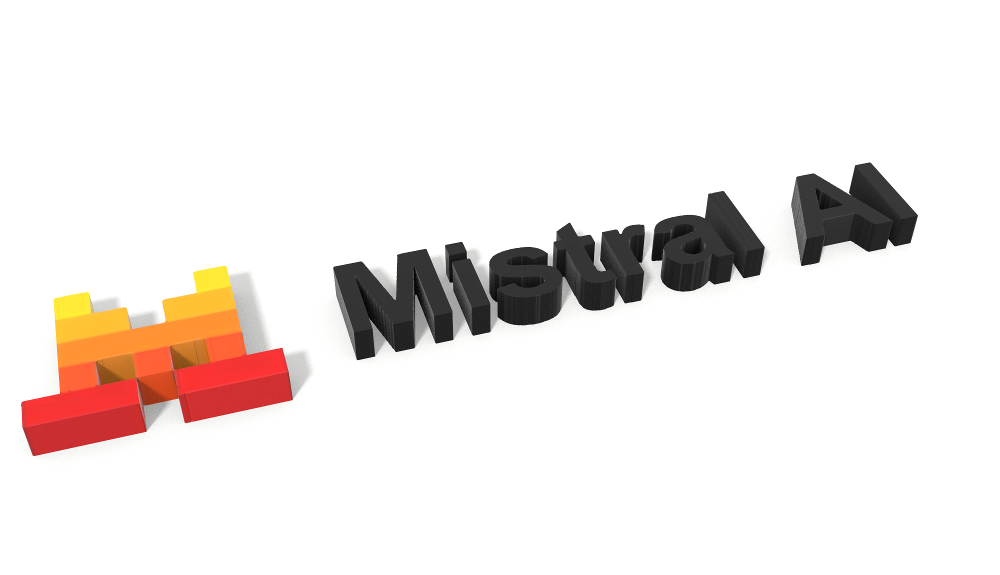
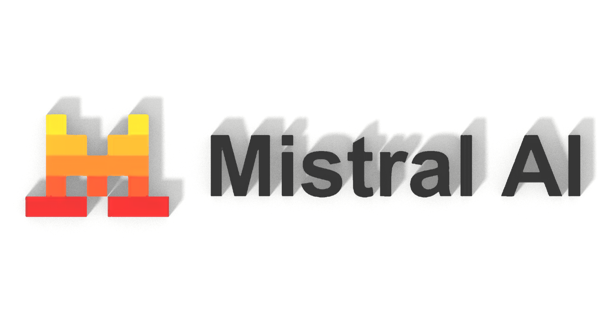

# A logo, copied exactly into 3D



`logo.png` raised into a 150 mm wide, 6 mm deep solid with one `image` object, every column in the colour of the
pixel it came from. The scene was built through Paper Mache's own MCP tools (`material_set`, `object_add`,
`camera_set`, `lights_set`, `render`, `scene_save`), as a coding agent would. From the top of the repository:

```sh
papermache render examples/mistral/scene.json -o mistral.png   # the side view above
papermache render examples/mistral/top.json -o top.png         # straight down
papermache export examples/mistral/scene.json -o logo.stl --tag logo   # 44,232 triangles, ready to print
```



## How exact

Rendered straight down at one pixel a pixel, the solid's outline matches the picture's own at an intersection over
union of 0.987: of 19,000 solid pixels, the 243 that differ are all anti-aliased edge pixels, half covered in the
picture itself. No solid pixel is missing and no background pixel is filled. The colours are the picture's own,
read straight from its pixels.

## Its colours, checked with oklch

Each band of the mark, measured at the centre of its cells, and the wordmark, against the logo's white ground
(oklchemy, WCAG 2 and APCA, as graphics, so the large-text goal: 3:1 and Lc 45). The copy keeps them exactly; the
check says which would need a darker shade if the mark were ever used small or as text on white.

| Band | Hex | oklch | WCAG on white | APCA Lc | Large-text AA |
| --- | --- | --- | --- | --- | --- |
| 1, top | #FED600 | oklch(0.884 0.182 95.3) | 1.42 | 19.9 | no: #AF9308 would pass |
| 2 | #FFAF01 | oklch(0.811 0.170 75.8) | 1.84 | 34.4 | no: #C88806 would pass |
| 3 | #FF8103 | oklch(0.733 0.185 53.3) | 2.50 | 48.7 | no: #E87505 would pass |
| 4 | #F8500E | oklch(0.660 0.214 37.4) | 3.42 | 60.8 | yes |
| 5, bottom | #E50403 | oklch(0.580 0.237 29.2) | 4.83 | 71.8 | yes (AA for text too) |
| Wordmark | #060606 | oklch(0.122 0 0) | 20.26 | 106 | yes (AAA) |

## Trademark

Mistral AI and its logo are trademarks of Mistral AI. The logo is here only as a test of the `image` shape; Paper Mache
is not made by, affiliated with or endorsed by Mistral AI, and the MIT license covers Paper Mache's code, not this logo.
